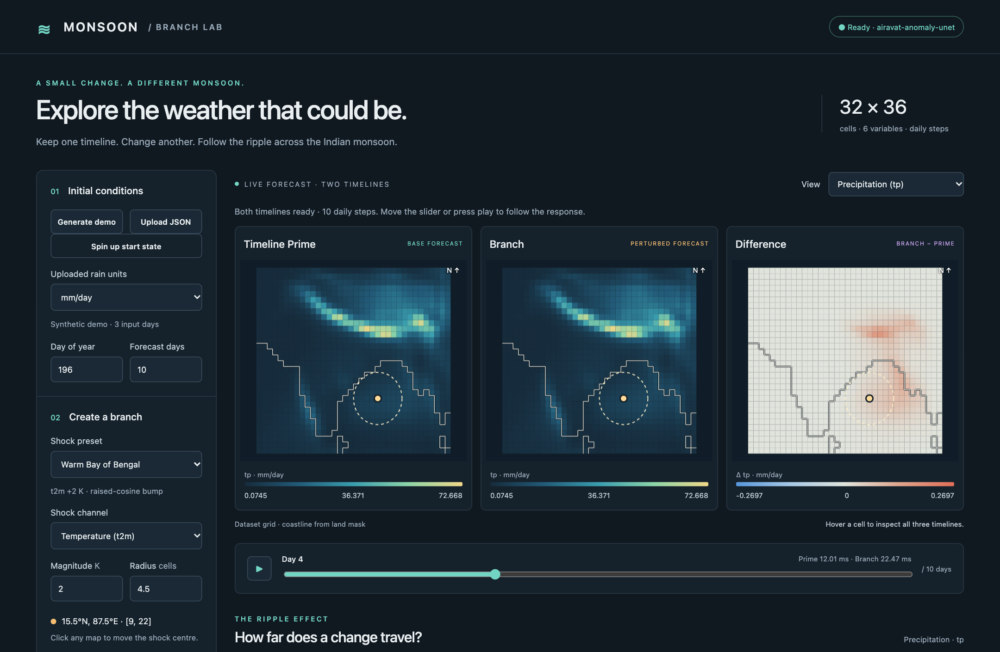

# Live counterfactuals and land exposure

## Follow a shock through the forecast

Start from a synthetic three-day window, upload three observations, or spin up the synthetic seed for 14 days and reuse its final three outputs. Choose a preset or place a custom shock. Prime and Branch use the same inputs, season, and forecast horizon. Branch adds the shock to the final input day. All forecast maps and impact values come from live CPU rollouts.

*The Bay of Bengal demo uses synthetic inputs. On day 4, the peak rain difference was 0.17 mm/day and the response footprint was 141 cells. The footprint is the smallest set of cells containing 90% of the squared rainfall response.*

## Use case and limits

For a rainfall preparedness discussion, compare cumulative rain, heavy-rain days, and the rain deficit index across 736 land cells. The index uses a user-selected daily need. Heat days use the daily mean temperature. Thresholds can be adjusted against the same forecasts.

The sensitivity ensemble combines Prime with eight live forecasts using small localized temperature or wind perturbations. Shaded ranges span the nine member land means. The selected day's exceedance probabilities average the fraction of members crossing each threshold across land cells. These frequencies describe the tested scenarios. The ensemble has no probability calibration or observed impact validation.
