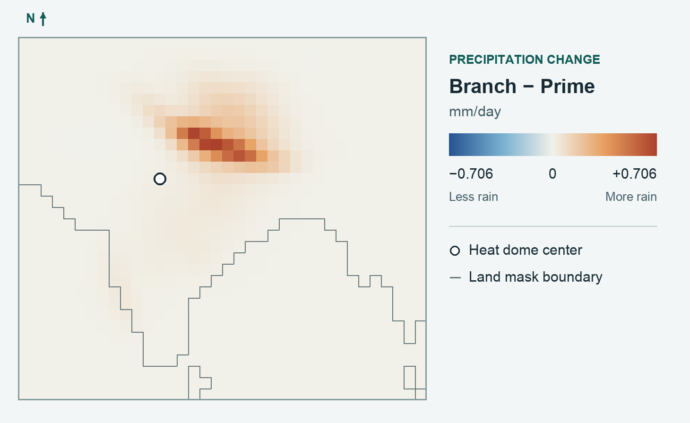

# From a rain response to a decision

Run both timelines with the **Heat dome** preset. Branch adds a localized +4 K temperature shock to the synthetic input. The warm anomaly is carried by the response transport, and the learned coupling produces a local rain response. This illustrates how the model responds to warming in the scenario.

*Day 4. The largest absolute difference was 0.706 mm/day. The 37-cell footprint is the smallest set containing 90% of the squared rain response.*

## Where to schedule a drain inspection

Use the Heavy-rain days layer to decide which grid cells to review for a pre-event drain inspection. Flag land cells reaching **64.5 mm or more in 24 hours**, the lower bound of the India Meteorological Department's heavy rainfall category.

> **Example from the live demo**
> Of 736 land cells, 5 reached the threshold in each timeline. Threshold crossings occurred on days 3, 4 and 5 in both Prime and Branch.

The outputs describe synthetic scenarios. Ensemble exceedance frequencies are uncalibrated, and the rain layer has no validation against observed impacts.

[India Meteorological Department, SOP for Weather Forecasting and Warning, table 1.5](https://mausam.imd.gov.in/imd_latest/contents/pdf/forecasting_sop.pdf)
