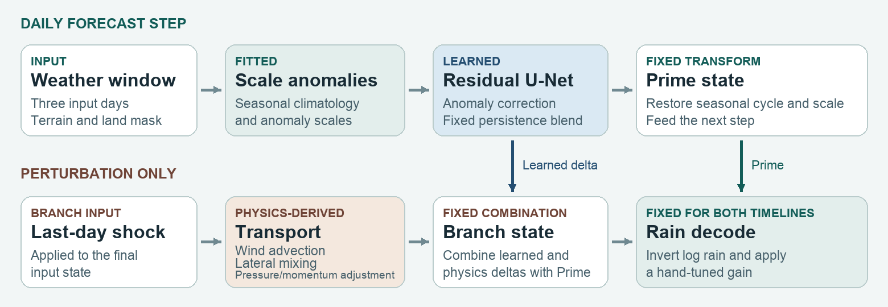

# A CPU weather twin for monsoon scenarios

Airavat forecasts daily weather by learning deviations from a fitted seasonal cycle. Prime is the reference. Branch applies a localized shock to the final input state and advances the learned response alongside wind-driven transport and pressure and momentum adjustments.

## Held-out skill against the stronger baseline

Skill compares the model's RMSE with the lower RMSE of persistence and climatology for each variable and lead. Positive values indicate lower error.

| Lead (days) | t2m | tp | u10 | v10 | msl | tcwv |
| ---: | ---: | ---: | ---: | ---: | ---: | ---: |
| 1 | +24.11% | +23.53% | +21.08% | +25.28% | +30.98% | +29.36% |
| 4 | +17.56% | +2.46% | +13.86% | +9.95% | +13.36% | +16.57% |
| 8 | +4.99% | -3.87% | +2.58% | +0.16% | +3.92% | +1.69% |

## Where the model can fail

Rolling the model forward can accumulate error and smooth local rain peaks. Day-8 precipitation RMSE is 3.9% worse than climatology on held-out windows, and the precipitation variance ratio falls to about 0.72. The winter disturbance proxy had zero heavy-rain hits at days 4 and 8.

> **What the numbers cover**
> **Held out.** The table uses 721 windows from 2020-2021 and a train-only checkpoint fitted on 2005-2019 using the shipped training recipe.
> **In sample.** The shipped checkpoint was fitted on 2005-2021. It has no clean out-of-sample skill score. The dashboard demo uses synthetic inputs.
> **Hidden organizer cases.** Unverified.
